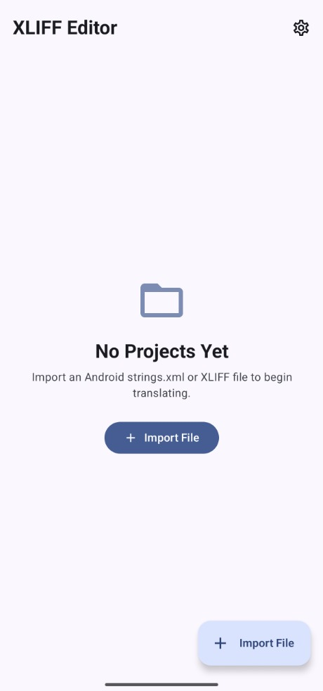
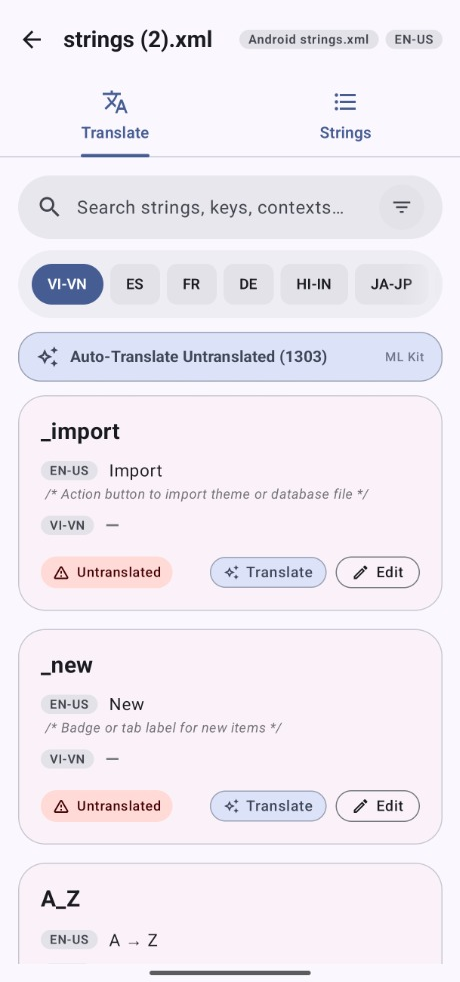
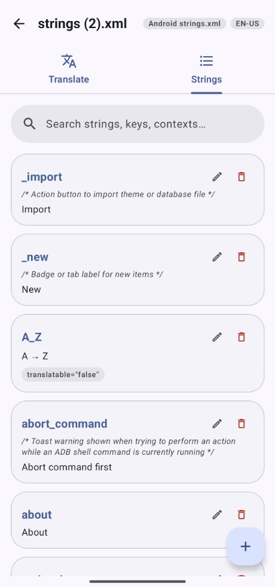
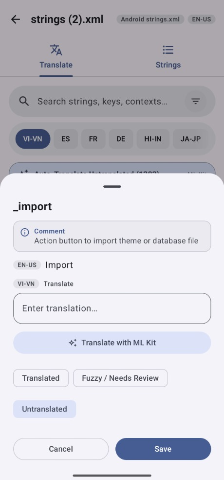

# XLIFF Editor

A localization and translation tool for Android to view, edit, and translate Android `strings.xml` and standard XLIFF (`.xliff`, `.xlf`) files directly on your device.

## Screenshots

| Home | Translate | Strings Catalog | Edit Translation |
| :---: | :---: | :---: | :---: |
|  |  |  |  |

## Features

- **Format Support**:
  - Import and parse Android `strings.xml` and XLIFF 1.2 (`.xliff`, `.xlf`) files via the system file picker.
  - XML sanitization handles unescaped ampersands, URLs, and HTML entities cleanly.
  - Automatically preserves developer comments (`comment`, `description`, `tools:comment`) and `translatable="false"` attributes.
  - Auto-detection of source language on import.

- **Translation Workspace**:
  - Quick target locale selector chips with smooth animations and edge haptic feedback.
  - Side-by-side view showing key name, source text, target translation, and status.
  - Status tracking: Translated, Fuzzy / Needs Review, and Untranslated.
  - Edit translations via modal bottom sheet with context, developer comments, and quick actions.

- **Offline On-Device Translation**:
  - Powered by Google ML Kit neural translation models.
  - Translate individual strings or batch auto-translate all untranslated strings in a project.
  - Completely offline with zero data sent to external servers.

- **Strings Catalog**:
  - Dedicated tab to browse, add, edit, and remove string keys and their comments.
  - Search across keys, source text, and target translations with real-time filtering.
  - Status filter chips to quickly isolate untranslated or fuzzy strings.

- **ZIP Archive Export**:
  - Export all localized files bundled in a ready-to-use Android resource ZIP archive (`values/strings.xml`, `values-es/strings.xml`, `values-fr/strings.xml`, etc.).
  - Select individual or all target locales to include in the export.

- **Modern Android UI**:
  - Built with Jetpack Compose and Material 3 Expressive.
  - Material You dynamic color support, Light, Dark, and AMOLED Black theme modes.
  - Predictive back gestures and edge-to-edge layout.
  - Subtle haptic feedback across list scrolling, buttons, and selection chips.

## Building from Source

Requirements:
- Android Studio Ladybug or newer
- JDK 17 or higher
- Android SDK API 35

```bash
git clone git@github.com:DP-Hridayan/XLIFF-Editor.git
cd XLIFF-Editor
./gradlew assembleRelease
```

The output APK will be located at `app/build/outputs/apk/release/app-release.apk`.

## Support

If you find this project useful, you can support development at [buymeacoffee.com/hridayan](https://buymeacoffee.com/hridayan).

## License

This project is licensed under the Apache License 2.0. See [LICENSE](LICENSE) for details.
